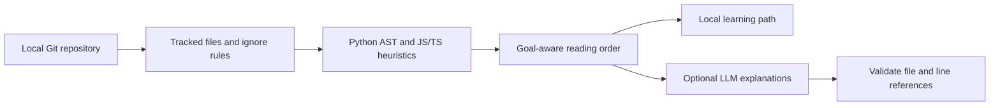

# CodeTrail

### Find your first step in any codebase.


A local repository map and learning-path generator. It inspects tracked text files without executing project code, then orders a short reading route for your learning goal.

> **Portfolio release:** 6 offline tests pass on Windows with Python 3.11.9. Local CLI examples and dependency consistency were checked. Live LLM calls and answer quality remain unverified.

## What you can explore

| Capability | Implementation |
|---|---|
| Repository scope | Git-tracked text files, current ignore rules, and path containment |
| Static map | Python functions/classes/imports and basic JS/TS declarations |
| Learning route | README and manifests first, then entry points and goal-related files |
| AI mode | Sends selected metadata only; validates returned file and symbol line anchors |
| Read-only operation | No imports, installation, hooks, or execution of target project code |

## How it fits together



## Quick start

Use Python 3.11 or newer. Run from the repository root. Git is also required for CodeTrail.

```powershell
git clone https://github.com/TanjayaJason/CodeTrail.git
cd CodeTrail
python -m venv .venv
.\.venv\Scripts\Activate.ps1
pip install -e ".[ai]"
Copy-Item .env.example .env
```

Skip the copy if `.env` already exists. On macOS/Linux, activate with `source .venv/bin/activate` and copy with `cp .env.example .env`.

```powershell
codetrail .
codetrail D:\PageProof --goal "Understand PDF retrieval"
codetrail . --json
```

## Optional AI mode

Fill `OPENAI_API_KEY` and `OPENAI_MODEL` in your local `.env`. Set `OPENAI_BASE_URL` only when using a compatible endpoint. The endpoint must support tool/function calling. Installing the AI extra does not enable model calls: opt in with `--ai` or the PageProof sidebar toggle.

```powershell
codetrail . --goal "Understand command routing" --ai
```

Provider calls use a 45-second timeout and no automatic retries. Invalid structured responses are rejected. No API keys are included in this repository.

## Limits you should know

Git must be available. At most 5,000 tracked paths, 100 KB per file, and two MB of selected text. Hidden paths, generated/vendor directories, symlinks, unsupported formats, and ignored files are skipped. Python analysis uses AST; JS/TS uses regex and is incomplete. Learning order and relationships are inferred, not a runtime dependency graph. AI sees file paths and symbol/import names, which can still reveal private project metadata.

User input is treated as evidence, never executable instructions. Model output remains advisory. Keep private documents, logs, datasets, repositories, and generated reports out of Git; `data/`, `reports/`, and `.env` are ignored.

## Repository guide

```text
src/codetrail/
  core.py          Domain logic and evidence handling
  cli.py           Command-line entry point
  support.py       Bounded input and optional provider boundary
docs/
  PRD.md           Product scope and acceptance goals
  DESIGN.md        Architecture and implementation decisions
  STATUS.md        Delivery and validation status
.agents/skills/codetrail/SKILL.md
AGENTS.md          Guidance for future coding work
.env.example       Empty configuration template
```

## Where this goes next

- Resolve local imports into navigation links.
- Add tree-sitter for richer TypeScript support.
- Evaluate learning routes against small public example repositories.

## Project notes

Read the [PRD](docs/PRD.md), [design](docs/DESIGN.md), and [delivery status](docs/STATUS.md) for scope and tradeoffs. Offline correctness checks are recorded in the delivery status; no model-quality or performance benchmark is claimed. A license has not been selected; no broad reuse rights are implied.

## Running the offline checks

```powershell
pip install -e ".[dev]"
python -m pytest -q
python -m pip check
```

Tests use synthetic inputs and block external connections. PageProof permits loopback sockets for Windows asyncio. Model response validation uses local fakes, never a live LLM. Local examples and the test suites do not need an API key.
